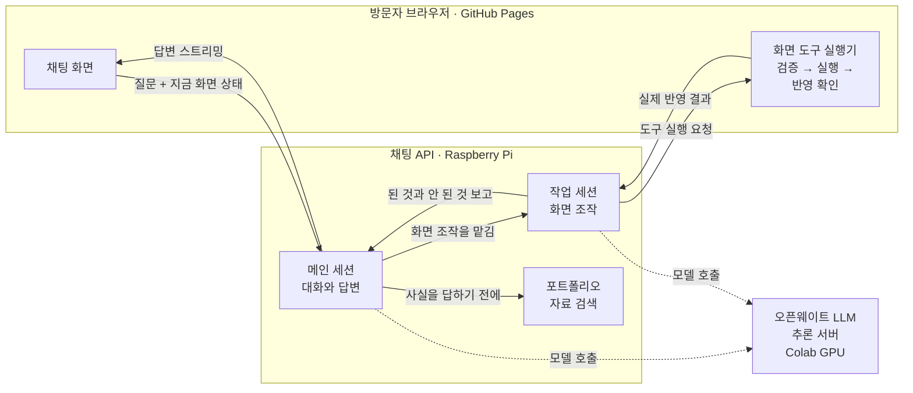
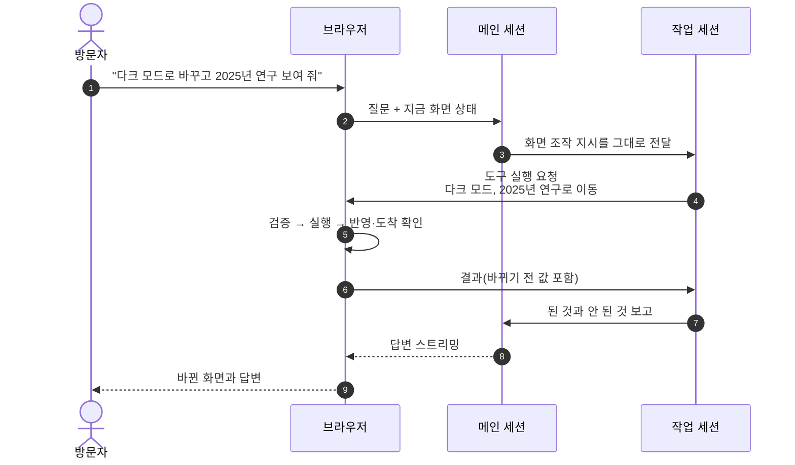

# SSW 소개 페이지

소프트웨어 엔지니어 송상운의 경험, 연구, 작업 방식과 가치관을 정리한 공개 포트폴리오입니다.

[소개 페이지 바로가기](https://s-work-song.github.io/ssw-portfolio-public/about-me/)

## 주요 구성

- **소개**: 주요 경력과 SI 에이전트들과 협업한 프로젝트를 소개합니다.
- **이력서**: 실무 경력, 역할과 기술 역량을 정리합니다.
- **자기소개서**: 개발을 대하는 관점과 협업 기준을 설명합니다.
- **연구 경험**: 하드웨어, 성능 최적화와 AI 에이전트 활용 과정을 기록합니다.
- **SI 활용 단계**: 챗봇 대화부터 여러 에이전트의 협업 조율까지 다섯 단계의 역할과 검토 범위를 소개합니다.
- **기록**: 기술적 성찰과 개인적인 경험에서 정리한 생각을 공유합니다.
- **포트폴리오 챗봇**: 사이트 안내를 위한 오픈웨이트 모델 챗봇입니다. 포트폴리오 내용을 질문으로 찾아보고, 말로 화면을 바꿀 수 있습니다.

## 포트폴리오 챗봇

모든 페이지 오른쪽 아래 버튼으로 여는 오픈웨이트 모델 챗봇입니다. 하는 일은 두 가지입니다.

- **질문에 답하기**: 이력·기술·프로젝트·연구처럼 포트폴리오에 관한 질문은 공개 자료를 먼저 검색하고,
  찾은 내용만 근거로 답합니다. 자료에 없으면 없다고 답합니다.
- **화면 바꾸기**: "다크 모드로 바꿔 줘", "2025년 연구 보여 줘"처럼 말로 화면을 조작합니다.
  - 테마·포인트 색상, 채팅 배치·글꼴·글자 크기·답변 연출을 바꿉니다.
  - 페이지와 연구 연도로 이동하고, 연구 상세를 펼치거나 접습니다.
  - 설정 페이지를 열고, 방금 바꾼 설정을 되돌립니다.
  - 바꿀 값을 말하지 않으면("포인트 색상 바꿔 줘") 답변 아래에 선택지 버튼을 띄웁니다.
    버튼은 대화 없이 바로 적용됩니다.

### 전체 구성

화면은 GitHub Pages에서, 채팅 API는 Raspberry Pi에서, 모델 추론은 Google Colab GPU에서 돌아갑니다.

- **역할 분리**: 메인 세션은 방문자와 대화하고 자료를 찾아 답합니다. 화면 조작은 직접 하지 않고
  작업 세션에 맡깁니다. 두 세션은 서로 다른 지침과 도구를 씁니다.
- **구조 실험**: 이 두 세션 구조는 지침을 하나로 합친 단일 세션부터 분류 단계를 강제한 구조까지
  다섯 단계 실험을 거쳐 나왔습니다. 과정은 [챗봇 판단 흐름](web/docs/chatbot-decision-flow.md#6-지금-구조가-되기까지)에 정리했습니다.
- **대화 이력은 서버에**: 브라우저는 질문 원문과 지금 화면 상태(설정 값, 보고 있는 페이지)만 보냅니다.
- **화면은 브라우저가 바꾼다**: 서버는 무엇을 바꿀지 요청만 합니다. 브라우저가 입력값을 검증해 실행하고,
  설정이 실제로 바뀌었는지와 페이지에 도착했는지 확인한 결과를 돌려줍니다. 그래서 챗봇은 실제로 된
  조작만 "바꿨다"고 말합니다.

### 질문 하나의 흐름

화면 조작이 섞인 질문 하나가 처리되는 순서입니다.

- 결과에 바뀌기 전 값이 들어 있어서 "원래대로 돌려 줘"라고 하면 그 값으로 되돌립니다.
- 답변이 실패하면 다시 보내기 버튼이 나오지만, 이미 화면을 바꾼 질문에는 나오지 않습니다.
  같은 조작이 두 번 일어나지 않게 하기 위해서입니다.
- WebMCP를 지원하는 브라우저에서는 AI 에이전트가 같은 화면 도구를 직접 부를 수 있습니다.
  실행 경로는 챗봇과 같습니다.

### 더 자세한 문서

- [챗봇 판단 흐름](web/docs/chatbot-decision-flow.md): 답변·자료 검색·화면 조작을 고르는 기준,
  자료 검색(RAG) 과정, 작업 세션의 도구 분류와 지금 구조에 이르기까지의 다섯 단계 실험을 정리했습니다.
- [챗봇 프런트엔드 구조](web/docs/chatbot-architecture.md): 모듈 구성, 요청 순서, 도구 실행 경로,
  말풍선 상태를 머메이드 그림으로 정리했습니다.
- [웹 README의 포트폴리오 챗봇](web/README.md#포트폴리오-챗봇): 오류·중단 시 화면 동작,
  [WebMCP 도구 목록](web/README.md#webmcp-도구), 설정 선택지 버튼을 설명합니다.

## 저장소 구성

| 경로 | 내용 |
| --- | --- |
| `web/` | Next.js 정적 export 프런트엔드. 화면·챗봇 UI·WebMCP 도구가 모두 여기 있습니다. |
| `web/docs/` | 프런트엔드 구조 문서. 챗봇 구조는 [`web/docs/chatbot-architecture.md`](web/docs/chatbot-architecture.md) 참고. |
| `benchmarks/` | 연구 경험 페이지가 인용하는 측정 근거. |
| `.github/workflows/` | GitHub Pages 배포 워크플로. |

## 유지 대상

- `web/src/app/about-me/`와 관련 콘텐츠 데이터 — 이 포트폴리오의 핵심 자산입니다.
  함부로 삭제하지 않습니다.
- `web/src/features/chat/`, `web/src/features/portfolio-tools/`,
  `web/src/features/webmcp/` — 챗봇과 도구 연동의 공개 구현입니다.
- `benchmarks/` — 연구 경험 페이지의 수치가 근거로 삼는 자료입니다.
- 배포 워크플로와 `NEXT_PUBLIC_BASE_PATH` 설정 — 저장소 이름을 바꾸면
  `package.json`, 워크플로, 문서의 공개 URL을 함께 맞춰야 합니다.

## 이 저장소에 두지 않는 것

- 챗봇 서버(채팅 API와 모델 세션), 프롬프트, 자료 색인 파이프라인과 인증 정보
- 기록(로그) 원문 — 비공개 저장소의 `content/logs/public|hold`에서 관리하고,
  이 저장소에는 API로 조회하는 UI만 둡니다.
- 개인 식별 정보가 담긴 원본 자료와 작업용 임시 폴더(`.agents-ssw/`)
