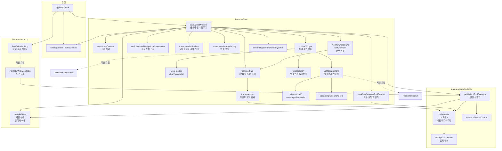
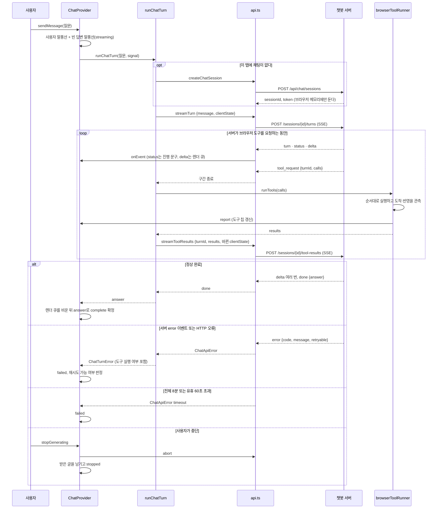
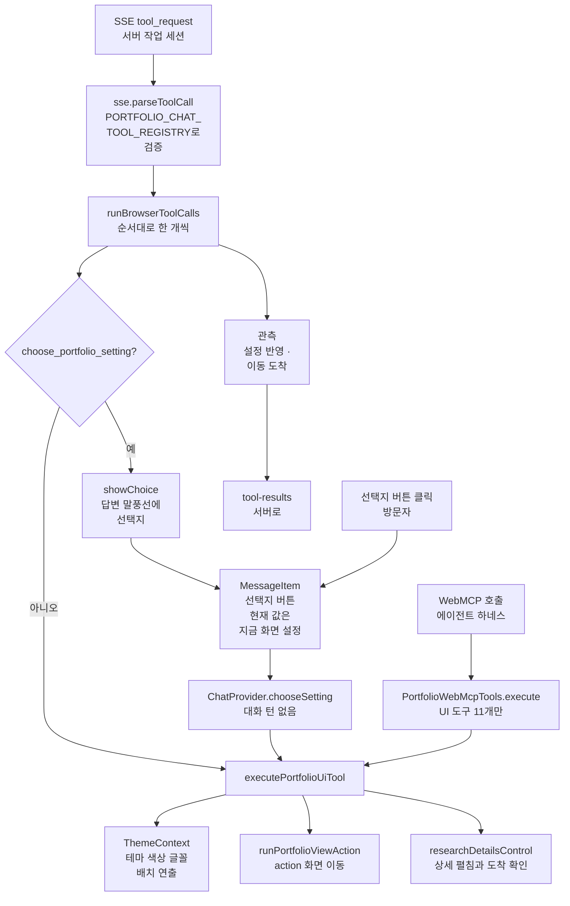
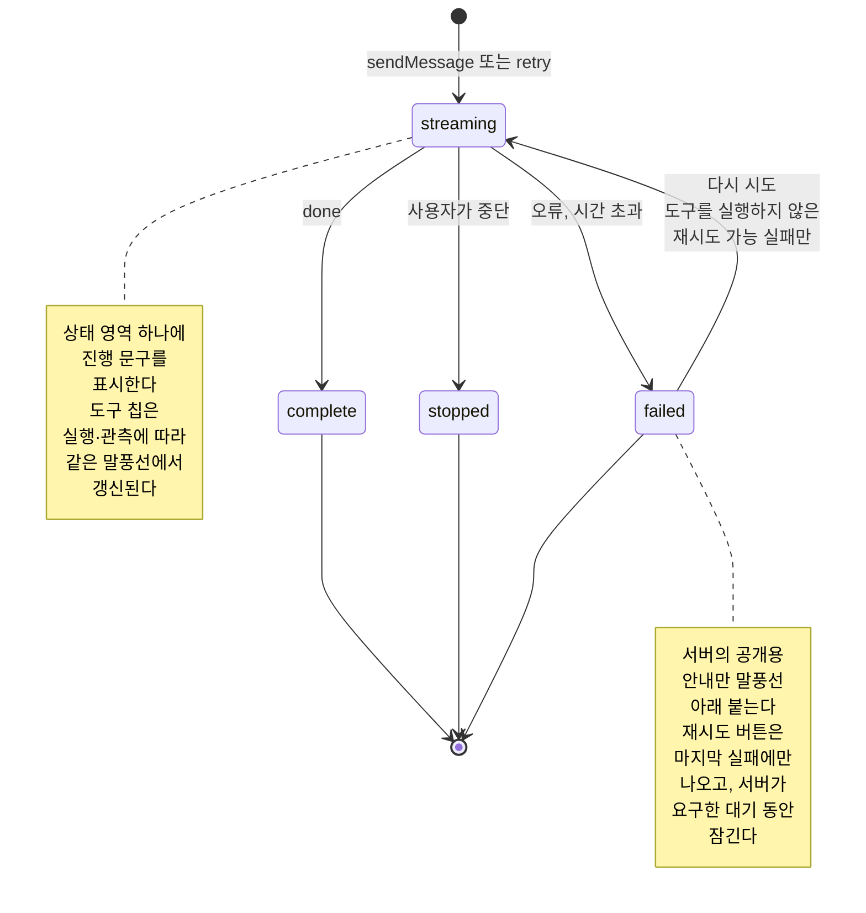
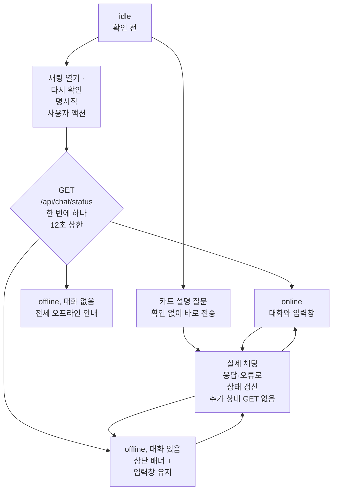

# 포트폴리오 챗봇 프런트엔드 구조

공개 포트폴리오에 붙어 있는 오픈웨이트 모델 챗봇의 프런트엔드 구조를 정리한 문서다.
2026-10-28 재작성 기준이다. 백엔드는 비공개 저장소에 있고, 이 저장소에는 브라우저에서
도는 코드만 있다. 서버가 답변·자료 검색·화면 조작을 고르는 기준과 검색 과정은
[chatbot-decision-flow.md](chatbot-decision-flow.md)에 따로 정리했다.

서버의 채팅 하나는 메인·작업 두 모델 세션을 갖고 **대화 이력은 서버가 보관한다**. 브라우저는
질문 원문과 현재 화면 상태(`clientState`)만 보낸다. 서버의 작업 세션이 화면 조작을 요청하면
브라우저가 실행하고 실제 반영을 관측해 결과를 돌려준다.

읽는 순서는 아래 네 그림을 따라가면 된다. 모듈이 어떻게 나뉘어 있는지, 질문 하나가 어떤 경로로
흐르는지, 화면을 바꾸는 여러 출발점이 어디서 합쳐지는지, 말풍선과 연결 상태가 어떻게 바뀌는지 순서다.

---

## 1. 모듈 의존 그래프

- 챗봇 상태는 전부 `ChatProvider` 한 곳에 있고, `ChatWidget` 아래 컴포넌트는 view-model이 투영한
  값을 그리기만 한다. 그래서 말풍선에 `memo`가 걸려도 안전하다.
- `chatTurn`·`browserToolRunner`·`toolNavigationObservation`·`sse`는 React와 DOM을 모르는 순수 흐름이다.
  네트워크·실행기·관측 함수를 주입받으므로 `node --test`가 브라우저 없이 그대로 실행한다.
- settings·view 도메인의 입력 정의가 허용값, TypeScript 입력 타입, WebMCP JSON Schema, 실행 직전
  파서를 함께 만든다. 서버 쪽 같은 목록(비공개 백엔드의 작업 세션 도구 정의)과는 저장소가 갈라져 있어
  **수동 동기화**다. 비공개 저장소 테스트가 옆에 체크아웃된 이 저장소의 정의와 이름·인자·enum을 대조한다.
- 점선 세 개가 지연 로딩 경계다. 마크다운 렌더러는 채팅을 열 때, 젤리 엔진은 패널이 열릴 때,
  WebMCP 도구 등록은 `document.modelContext`가 있을 때만 받는다.

---

## 2. 질문 하나의 요청 시퀀스

- **세션**: 첫 질문에서 서버 채팅을 만들고 `sessionId`·`token`은 브라우저 메모리에만 둔다. 새 대화,
  페이지 이탈, 언마운트에서 `close`를 keepalive로 보낸다(토큰을 `text/plain` 본문에 실어 CORS 사전 요청이
  없다). 실패해도 서버 유휴 TTL이 정리한다.
- **만료된 채팅**: 턴을 시작할 때 `404 session_not_found`가 오면 그때만 새 채팅을 만들어 같은 질문을 한 번
  다시 보내고, 앞선 대화가 이어지지 않는다는 안내 말풍선을 끼워 넣는다. 도구 결과를 보내는 도중의 404는
  다시 보내지 않는다.
- **clientState**: 요청을 보내는 순간의 UI 설정과 URL·DOM 기반 화면 상태다. 도구를 실행한 뒤의
  tool-results에는 바뀐 상태가 실린다. 서버의 작업 세션은 이 값으로 조회 도구에 바로 답한다.
- **시간 상한**: HTTP 구간마다 전체 8분, 유휴 60초다. 유휴 타이머는 바이트가 올 때마다 되감기고
  서버는 10초마다 주석 줄을 보낸다. 만료로 끊긴 경우에만 `timeout` 코드가 붙어 사용자 중단과 구분된다.
- **스트리밍**: delta는 도착 즉시 렌더 큐에 넣고 네트워크 읽기는 멈추지 않는다. 화면 재생 속도와 수신
  속도를 분리해 연출이 느려도 스트림이 밀리지 않는다. 마지막에는 `done.answer`로 본문을 확정한다.
- **진행 문구**: `status` 이벤트의 `answering`·`searching`·`working`이 "응답 생성 중"·"자료 찾는 중"·
  "화면 조작 중"이 된다. 오래 걸리면 같은 자리의 문구만 바꾼다.
- **재시도**: 서버가 재시도 가능하다고 한 실패 중 **이번 턴에 브라우저 도구를 실행하지 않은 경우**만
  같은 질문을 다시 보낼 수 있다. 이미 바뀐 화면을 다시 조작하지 않기 위해서다. 429의 `Retry-After`는
  버튼을 잠그고 남은 초를 센다.
- **실패 표시**: 서버가 준 공개용 안내 문구(없으면 기본 문구)만 말풍선 아래에 붙인다. 정확한
  `localhost`·`127.0.0.1`·`[::1]`에서만 허용 목록의 오류 코드와 재시도 대기를 콘솔에 남긴다. 질문·본문·
  오류 객체는 남기지 않는다.
- **중단**: 렌더 큐를 먼저 비우고 요청을 끊는다. 서버는 연결이 끊긴 것을 보고 그 턴을 멈춘다.
  브라우저 도구를 실행하던 중이었다면 서버 턴은 다음 질문이 올 때 정리된다.

---

## 3. 도구 실행이 한곳으로 모이는 길

화면을 바꾸는 출발점은 셋이다. 서버 작업 세션의 `tool_request`, WebMCP 에이전트의 호출, 설정 선택지
버튼 클릭이다. 셋 다 같은 `executePortfolioUiTool`을 지난다.

- 검증은 한곳이다. 도메인 입력 정의가 SSE 파서와 WebMCP 등록·실행 양쪽에 쓰여, "챗봇으로는 되는데 도구로는
  안 되는" 차이가 생기지 않는다. 모르는 도구 이름이 오면 파서가 `invalid_response`로 턴을 끝낸다. 그래서
  도구를 더할 때는 이 프런트를 먼저 배포한다.
- 서버 작업 세션은 UI 도구 11개에 채팅 전용 `choose_portfolio_setting`을 더한 12개를 브라우저에 요청할 수
  있다. 작업 세션의 나머지 도구(시계, 그리고 `clientState`로 답할 수 있는 조회)는 서버가 바로 답해
  브라우저로 오지 않는다. 같은 묶음에서 앞선 화면 조작이 있으면 조회도 브라우저로 온다.
- 한 번에 온 호출은 순서대로 실행하고 앞 도구의 관측이 끝난 뒤 다음으로 넘어간다. 중단하면 남은 도구는
  실행하지 않고 이미 바뀐 화면은 그대로 둔다.

결과 `output`은 서버 작업 세션의 모델이 읽는 tool 결과가 된다. 그래서 "요청했다"가 아니라 "반영됐다·
도착했다"를 확인한 뒤 돌려준다. 모든 도구는 시작부터 최소 500ms 뒤에 결과를 낸다.

| 도구 | 브라우저가 확인하는 것 | 성공 output | 실패 |
| --- | --- | --- | --- |
| `set_portfolio_*` | 설정 값이 실제로 바뀌었는지(50ms 간격, 최대 1.2초) | 바꾼 값, `previous` | `not_applied` |
| `control_portfolio_view`, `open_portfolio_settings` | 실제 경로, 대상 DOM 준비, 앵커 도착 신호(최대 8초) | `action`, `route`, `label`, `arrived`, `previous{page, anchor}` | `not_arrived` |
| `control_portfolio_research_details` | 목표 앵커 도착·정렬과 대상 카드 전부의 펼침 상태(최대 8초) | 실행기 출력, `status: applied` | `not_applied` |
| `get_portfolio_*` | 없음(그대로 읽음) | 실행기 출력 | 실행기 출력 |
| `choose_portfolio_setting` | 없음(선택지를 띄우고 바로 끝남) | `setting`, `shown: true`, `current` | `unsupported_tool` |

- `previous`는 작업 세션이 "되돌려"에 쓴다. 선택지 결과의 `current`는 띄울 때의 값이다. 버튼은 턴과
  무관하게 바뀌므로, 선택지를 띄운 설정을 되돌릴 때는 이 값을 쓴다.
- 이동 완료는 URL 변경만으로 보고하지 않는다. 앵커 도착은 활성 패널·포커스·실제 상단 정렬로 확인하고,
  숨김·전환 중인 요소는 완료로 보지 않는다. Swiper 높이 전환으로 좌표가 달라지면 제한 시간 안에서
  다시 계산한다.
- 상세 제어는 요청 게시 전에 목표 앵커의 도착 신호를 구독해 빠른 이동도 놓치지 않는다. 카드가 먼저
  바뀌어도 스크롤 중이면 끝내지 않고, 실패·취소·예외 때 구독을 정리한다. 모두 사용자 명령 뒤의 로컬 DOM
  관측이며 서버 상태를 폴링하지 않는다.

### 설정 선택지

"포인트 색상 바꿔 줘"처럼 값 없이 설정 변경을 요청하면 작업 세션이 `choose_portfolio_setting({setting})`을
부른다. `setting`은 `theme`·`accent`·`chat_layout`·`chat_font`·`chat_font_size`·`stream_animation` 중 하나다.

- `browserToolRunner`가 답변 말풍선에 `settingChoice`를 붙이고 바로 결과를 돌려준다. 턴은 이어서 끝난다.
- `messageViewModel`이 선택지를 버튼 목록으로 투영한다. 현재 값 표시는 띄울 때가 아니라 지금 화면 설정을
  따르므로, 여러 번 눌러 비교해도 표시가 맞는다. 포인트 색상은 견본 색을 함께 보여 준다.
- 버튼은 `ChatProvider.chooseSetting`이 대화 턴 없이 같은 setter 경로로 바로 적용한다. 바뀐 값은 다음
  질문의 `clientState`로만 서버에 전해진다.
- 스트리밍 연출 선택지는 가리킨 버튼(없으면 현재 값)으로 예시 문장을 다시 재생하는 미리보기를 붙인다.
- 지난 답변의 선택지도 계속 누를 수 있다. 한 답변에 선택지가 두 번 오면 마지막 것만 남는다.
- 채팅 화면이 있어야 하는 도구라 WebMCP에는 등록하지 않는다.

---

## 4. 답변 말풍선과 연결 상태

- 실패 상태는 하단 오류 상자가 아니라 그 말풍선 바로 아래에 붙는다. 어느 질문이 실패했는지가 함께 보여야
  재시도 판단이 선다. 재시도는 같은 말풍선을 교체한다.
- 실패해도 이미 실행한 도구 칩은 그대로 두고 "이미 바뀐 화면은 그대로 유지됩니다"를 덧붙인다.
- 대화 이력은 서버가 갖고 있으므로 화면 메시지를 새로고침에서 복원하지 않는다.

- 연결 상태는 `useChatAvailability`와 `chatAvailability`가 관리한다. mount, 일정 주기, 탭 복귀, 창 포커스,
  네트워크 복구에서 자동 상태 GET을 하지 않는다. 채팅을 여는 액션과 "다시 확인" 버튼에서만 확인하고,
  겹치는 액션은 진행 중인 요청을 공유한다. 브라우저의 네트워크 단절 이벤트는 GET 없이 반영한다.
- 확인된 온라인 뒤 시간 초과 한 번은 온라인을 유지한다. 초기·연속 시간 초과, 인증 실패, 서버의 명시적
  오프라인(역할 모델이 빠진 `degraded` 포함)은 오프라인으로 반영한다.
- 실제 채팅 응답은 진행 중인 상태 조회보다 우선한다. 성공하면 온라인, 연결 실패 계열 오류
  (`network`, `upstream_unreachable` 등)만 오프라인으로 바꾼다. 생성 시간 초과·혼잡·도구 실패로는
  연결 상태를 바꾸지 않는다.
- 대화 중 오프라인이면 화면을 갈아 끼우지 않고 배너만 띄운다. 입력창을 유지해 다시 보내 볼 수 있고,
  성공하면 온라인으로 돌아온다.
- `AI에게 물어보기`·관점 선택·추천 질문 같은 카드 설명 질문은 확인 전(idle)에도 상태 GET 없이 보낸다.
  일반 입력은 확인 전에는 보내지 않는다.

---

## 관련 파일

| 관심사 | 파일 |
| --- | --- |
| 상태와 턴 수명주기 · 선택지 적용 | `src/features/chat/state/ChatProvider.tsx`, `ChatContext.tsx` |
| 턴 흐름(세션 생성·만료 재시도·도구 왕복) | `src/features/chat/workflow/chatTurn.ts`, `tests/features/chat/workflow/chatTurn.test.mjs` |
| 브라우저 도구 실행·관측·선택지 표시 | `src/features/chat/workflow/browserToolRunner.ts`, `tests/features/chat/workflow/browserToolRunner.test.mjs` |
| 이동 도착 판정 | `src/features/chat/workflow/toolNavigationObservation.ts`, `tests/features/chat/workflow/toolNavigationObservation.test.mjs` |
| 도구 칩 문구 | `src/features/chat/workflow/toolResultPresentation.ts`, `src/features/chat/constants.ts` |
| HTTP·SSE 소비와 시간 상한 | `src/features/chat/transport/api.ts` |
| SSE 이벤트 계약 검사 | `src/features/chat/transport/sse.ts`, `tests/features/chat/transport/sse.test.mjs` |
| 실패 표시 · 로컬 진단 · 재시도 대기 | `src/features/chat/transport/chatFailure.ts`, `tests/features/chat/transport/chatFailure.test.mjs` |
| 연결 상태 | `src/features/chat/transport/chatAvailability.ts`, `useChatAvailability.ts`, `tests/features/chat/transport/chatAvailability.test.mjs` |
| 말풍선 투영 · 선택지 버튼 | `src/features/chat/view-model/messageViewModel.ts`, `src/features/chat/ui/MessageItem.tsx` |
| 패널 셸과 연출 | `src/features/chat/ui/ChatWidget.tsx`, `src/features/chat/view-model/chatViewModel.ts` |
| 스트리밍 재생 | `src/features/chat/streaming/streamRenderQueue.ts`, `StreamingText.tsx` |
| 도구 계약 단일 소스 | `src/features/portfolio-tools/contract.ts`, `settings.ts`, `view.ts`, `schema.ts` |
| 도구 실행기 · 연구 상세 제어 | `src/features/portfolio-tools/portfolioUiToolExecutor.ts`, `researchDetailsControl.ts` |
| WebMCP 등록과 게이트 | `src/features/webmcp/PortfolioWebMcp.tsx`, `PortfolioWebMcpTools.tsx` |
| 화면 상태 읽기와 이동 목적지 표 | `src/features/webmcp/portfolioView.ts` |
