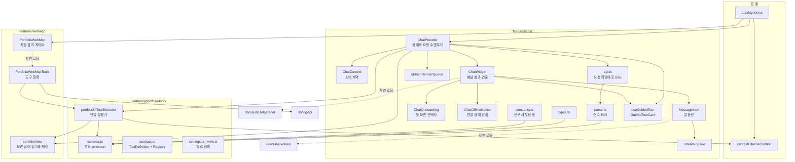
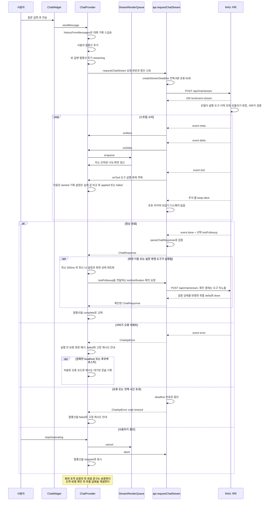
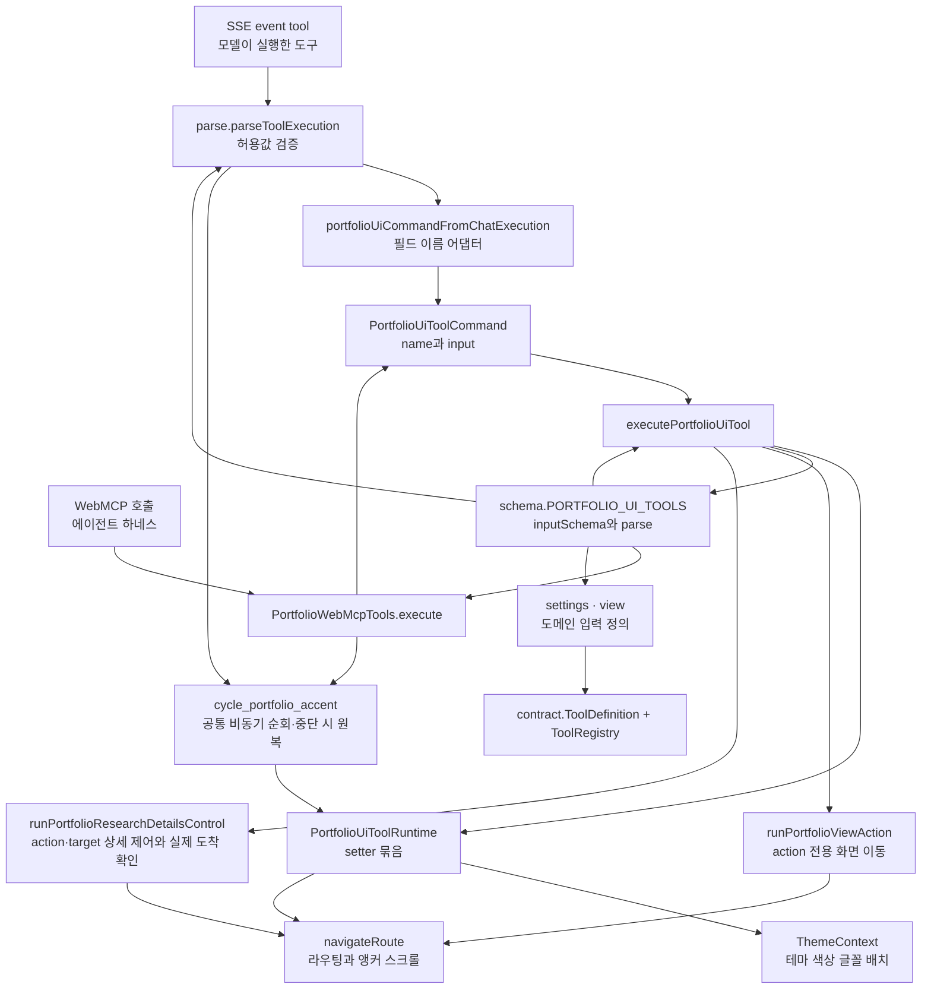
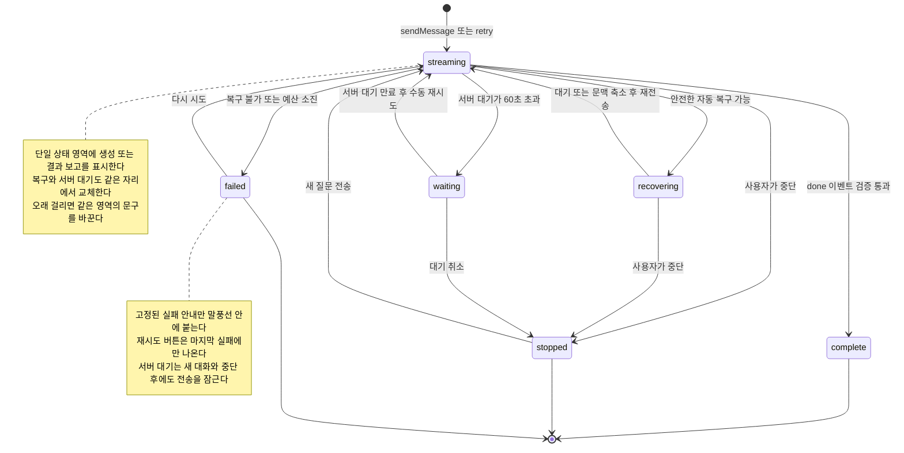
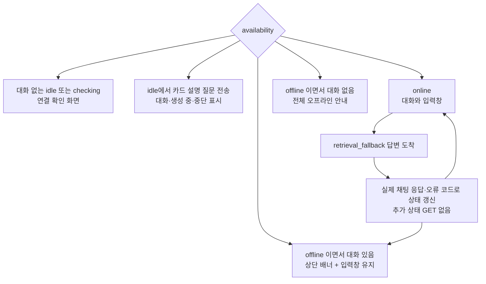

# 포트폴리오 챗봇 프런트엔드 구조

공개 포트폴리오에 붙어 있는 AI 챗봇의 프런트엔드 구조를 정리한 문서다.
백엔드(RAG 추론 서버)는 비공개 저장소에 있고, 이 저장소에는 브라우저에서
도는 코드만 있다.

읽는 순서는 아래 네 그림을 따라가면 된다. 모듈이 어떻게 나뉘어 있는지,
질문 하나가 어떤 경로로 흐르는지, 모델이 화면을 바꾸는 두 경로가 어디서
합쳐지는지, 실패했을 때 화면이 어떤 상태로 가는지 순서다.

---

## 1. 모듈 의존 그래프

- 챗봇 상태는 전부 `ChatProvider` 한 곳에 있고, `ChatWidget` 아래의 컴포넌트는
  받은 것을 그리기만 한다. 그래서 말풍선에 `memo`가 걸려도 안전하다.
- settings·view·logs 도메인의 `ToolDefinition` 입력 정의가 허용값, TypeScript 입력
  타입, WebMCP JSON Schema와 실행 직전 파서를 함께 만든다. `ToolRegistry`는 등록 전에
  중복·형식 오류를 막고, `schema.ts`는 파서·실행기의 호환 진입점으로 같은 정의를 재수출한다.
  이 단일 소스는 저장소 안에서만 유효하다. 서버 목록(비공개
  `backend/src/shared/view-targets.js`)과는 **수동 동기화**이므로, 이동
  목적지를 더할 때는 양쪽을 함께 고쳐야 한다. 프런트 테스트가 목적지 개수를
  못 박아 두어, 한쪽만 고치면 최소한 개수에서 걸린다.
- 점선 세 개가 지연 로딩 경계다. 마크다운 렌더러는 채팅을 열 때, 젤리 엔진은
  패널이 열릴 때, WebMCP 도구 등록은 `document.modelContext`가 있을 때만 받는다.
- `api.ts`는 네트워크만, `parse.ts`는 검증만 맡는다. 파서에 런타임 의존이 없어
  `node --test`가 브라우저 없이 그대로 실행한다.

---

## 2. 질문 하나의 요청 시퀀스

- delta는 도착 즉시 렌더 큐에 넣고 네트워크 읽기는 멈추지 않는다. 화면 재생
  속도와 수신 속도를 분리해, 연출이 느려도 스트림이 밀리지 않게 한 것이다.
- `:`로 시작하는 주석 줄과 `event` 필드가 없는 블록은 디스패치하지 않는다.
  수신 자체가 생존 신호라 유휴 타이머만 되감는다.
- 시간 상한은 두 겹이다. 전체 8분은 처음부터 흐르고, 유휴 60초는 바이트가
  올 때마다 초기화된다. 만료로 끊긴 경우에만 `timeout` 코드가 붙어, 사용자
  중단과 다른 실패 상태가 남는다. 오류 원문은 표시하지 않는다.
- `done` 본문이 검증을 통과하지 못하거나 보여 줄 본문이 하나도 없으면
  각각 `invalid_response`와 `empty_answer`로 실패시킨다. 빈 말풍선이 화면에 굳는 것보다 낫다.
- 화면 이동·설정 변경 도구가 있으면 도구 큐가 실제 결말까지 기다린다. 첫 서버
  답변은 보류하고, 최소 500ms 뒤 현재 설정과 URL·DOM 기반 화면 상태를 다시 읽어
  `toolVerification` 확인 요청을 보낸다. 모델에는 확인 요청에서 도구를 다시
  노출하지 않으며, `arrived`·`applied`일 때만 완료형 답변을 재생한다.
  첫 응답의 선택 `toolFollowup`은 `explanationRequested`, `knowledgeRequested`, 선택
  `answerPlan`·`contextTopic`으로 구성되고 프런트가 확인 요청에 그대로 전달한다.
  UI 조회와 조작은 `true/false`, 본문 설명과 조작은 `true/true`, 단순 조작은
  `false/false`다. `knowledgeRequested=true`일 때만 답변 범위와 문맥 주제를 전달한다.
  질문 문구를 하드코딩해 이 분기를 만들지 않는다. 구형 서버가 `toolFollowup`을 보내지
  않은 경우에만 기존 `uiOnly === false` 규칙으로 설명 요청을 만든다.
- 확인 요청은 원래 질문과 대화 이력을 유지하고 사고 모드를 끈다.
  `requestVerifiedToolResponse`가 도구 실행 큐 완료 뒤에만 현재 URL·DOM 상태와 최신
  설정을 읽는다. 자료 기반 설명이면 서버가 원 질문과 `answerPlan`·`contextTopic`으로
  다시 검색하고 질문 범위와 persona를 적용한다. 검색 근거 원문은 프런트로 보내지 않는다.
  UI 조회 설명과 단순 조작은 RAG를 생략한다. 성공한 단순 조작도 모델이 최종 관측을
  바탕으로 답하며 고정 완료 문구를 붙이지 않는다. 서버는 최종 요청을 `tools: []`로
  보내므로 변경·이동을 다시 실행하지 않는다. 실패 관측이 있으면
  설명 생성 없이 확인된 성공·실패만 보고하는 기존 보호도 유지한다.
- 선택 `modelHistory`가 있으면 실제 assistant 호출·tool 결과·공개 최종 답변을 다음
  질문의 이력에 그대로 펼친다. ID·raw arguments·결과 문자열을 요약하지 않고,
  visible assistant를 중복하지 않는다. 브라우저 확인 전에는 임시 본문을 빼고 실제
  관측으로 해당 tool content만 교체해 `toolHistory`로 보낸다. 각 변경 결과에는 해당
  단계의 관측을 남기고, 공통 최종 화면 스냅숏은 마지막 변경 결과에 한 번만 포함한다.
  getter 원문과 native 호출 ID·인수·순서·전체 관측은 보존한다. 같은 설정 변경 기록을
  모든 결과에 복제하지 않는다. 앱의 고정 문자 수 예산은 적용하지 않으며, 실제 모델의
  토큰 한도와 출력 예산은 추론 서버가 판단한다.
  확인 요청만 실패한 재시도는 최초 전송 전에 검증·복제·동결한 같은 질문·입력 ID·
  관측 체인·최종 화면 스냅숏으로 보고만 요청해 변경 도구를 재실행하지 않는다.
  구형 API가 선택 필드를 생략하면 기존 일반 user/assistant 이력을 사용한다.
- 이력은 메모리에만 보관하고 정상 완료된 전체 대화 묶음을 유지한다. 최근 5턴,
  wire 130개·native 24/25개, 12,000/20,000자 같은 앱의 분량 제한으로 대화나 결과를
  자르거나 거부하지 않는다. 호출 ID·인수·결과 연결의 형식과 완결성은 계속 검증한다.
  비공개 system/RAG,
  추론 본문과 실행 전 완료 문장은 보관하지 않으며 전체 KV 캐시 적중을 보장하지 않는다.
  `supportedOptions`가 포함된 설정 카탈로그도 원문 이력에는 유지한다. 서버는 모델 입력에서만
  같은 카탈로그의 오래된 반복 사본을 축약하며, 가장 최근
  사본 또는 현재 native 체인의 첫 사본과 구조가 다른 버전은 보존한다.
  호출 ID·raw arguments·결과 연결·batch 순서는 바뀌지 않는다.
- 인사말 아래 안내 카드는 대화가 시작돼도 같은 스크롤 위치에 남는다. 온라인·투어
  미진행 조건은 유지하고, 답변 생성 중에는 카드의 버튼만 비활성화한다.
  관점 선택·추천 질문·카드의 AI 질문은 `responseMode: explanation`을 요청과 재시도에
  보존한다. 이 모드에서는 화면 조작을 모델에 맡기지 않고 설명을 받는다. 빠른 시작
  버튼의 명시적인 UI 이동은 기존 프런트 액션으로 수행한다.
  말투 선택 영역은 비활성화한 채 공식 안내자로 고정한다.
- `done.uiToolOutcome=called`는 서버가 지시를 보냈다는 뜻이지 화면 변경 완료가
  아니다. 일부만 지시했으면 `incomplete`, 도구가 불필요했으면 `not_required`다.
  `not_called`는 하위 호환값이고, 현재 필수 도구가 끝내 실패하면 `done` 대신
  오류 이벤트가 온다.
- 오류의 원문 `message`와 구형 서버의 선택 `explanation`은 화면에 넣지 않는다.
  사용자에게는 고정된 실패 상태와 재시도만 남긴다. 구형 `failure_explanation`
  메시지도 렌더와 대화 이력에서 제외한다. 이미 보인 정상 부분 답변은 실패
  상태로 보존하지만, 도구 실행 전 본문과 보류 delta는 오류 시 되살리지 않는다.
  정확한 `localhost`, `127.0.0.1`, `[::1]`, `::1`에서만 제한된 콘솔 진단을
  남긴다. LAN·공개 주소·localhost 하위 도메인·SSR은 출력하지 않는다.
  로그에는 허용된 오류 코드·재시도 대기만 포함하고 오류 객체, 원문, 질문,
  대화 이력, 요청 본문·헤더, 모델 추론은 포함하지 않는다.
- 복구 가능한 오류는 실패 상태를 먼저 표시하지 않고 같은 말풍선의 진행 상태를
  바꾼다. 요청 단계는 자동 재전송 최대 2회(같은 문맥 재전송은 합계 1회), 결과 보고는
  최대 1회이며 사용자 턴 전체는 최대 3회다. 이는 HTTP 복구 횟수로, 서버 내부 품질
  교정 횟수와 다르다. `retryExhausted: true`는 해당 단계의 자동 예산을 소진 처리하고
  수동 재시도로 되살리지 않는다. 도구가 발행되지 않은 요청 또는 검증·동결된 보고만
  복구한다. 부분 본문 뒤 통신이 끊겨도 이 조건이면 불완전한 현재 본문을 비우고
  같은 말풍선에서 다시 생성하며, 이전 본문에 새 답변을 이어 붙이지 않는다.
- `context_length_exceeded`, `request_too_large`, `payload_too_large`가 명시된 경우에만
  재시도용 이력 복사본을 축소한다. 최근 사용자 턴 하나를 보호하고 나머지 완결된
  과거 턴의 절반(올림)을 앞에서부터 제외한다. 현재 질문·명시 참조와 남은 native
  체인의 ID·원문·순서는 보존한다. 잘라낼 완결 턴이 없으면 자동 전송하지 않는다.
  다시 같은 용량 오류가 나면 예산 안에서 더 줄이고, 이후 수동 재시도도 마지막
  축소본을 기준으로 한다. 보고는 원본 스냅숏을 보관한 채 과거 `history`만 줄인
  별도 동결 복사본을 만든다. 현재 native 체인·관측·작업 범위·UI 상태는 바꾸지 않는다.
  화면 대화와 다음 새 질문의 원본 이력은 삭제하지 않으며, 첫 요청에는 상시 문자 수나
  턴 수 제한을 되살리지 않는다. 제외한 과거 대화의 의미까지 보존하는 요약은 아니다.
- 429와 일시 혼잡은 `Retry-After` 초 또는 HTTP 날짜의 not-before를 지킨다. 60초
  이하는 취소 가능한 자동 대기, 더 긴 값은 자동 예약 없이 중립 안내와 수동 재시도로
  전환한다. 중단·새 대화가 예약을 취소해도 서버가 요구한 전송 대기는 마운트 수명 동안
  유지한다. 입력 편집은 허용하고 대기 중 전송은 입력을 지우지 않고 차단한다.
  인증·모델 선택 변경·작업 범위/관측 계약 위반·원인 불명 내부 오류는 자동으로 고치지
  않는다. 범용 응답 형식 오류의 서버 교정 횟수도 늘리지 않는다. 자동 상태 폴링은 없다.
- 생성·보고·재시도·문맥 정리·남은 대기·장시간 안내는 말풍선 안 상태 영역 하나를
  치환한다. 임시 본문과 하단의 고정 검색 안내는 없다. 점 세 개는 순서대로 움직이고
  완료·실패·중단 시 사라지며 사이트 모션 끄기 및 시스템 reduced-motion을 따른다.
- API 본문의 선택 `conversationId`·`turnId`는 UUID다. 대화 ID는 여러 질문에
  걸쳐 유지하고 새 입력마다 턴 ID를 만든다. 같은 질문의 재시도·도구 후속
  확인은 pending에 캡처한 두 ID를 그대로 보낸다. 새 대화는 대화 ID를 바꾸며,
  메시지를 새로고침에서 복원하지 않으므로 ID도 브라우저 메모리만 쓴다.
  HTTP LAN에서 `crypto.randomUUID`를 쓸 수 없으면 `getRandomValues`로 v4 UUID를
  만든다. 질문·추론·프롬프트를 식별자로 사용하지 않는다. 추적 헤더와
  개별 모델 요청 ID는 백엔드/런처의 책임이며 공개 프런트는 만들지 않는다.

---

### 작업 범위와 실제 브라우저 관측

새 요청은 `portfolio-tool-task-v1`을 사용한다. 대화·턴 ID에 사용자 턴별 `taskId`와
실행 시도별 `generation`을 더하며, 이 값은 인증이나 서버 세션이 아니라 현재 요청의
동등성 확인용이다. `toolTaskRuntime.ts`가 meta/tool/done과 최종 확인 응답의 동일 scope,
0부터 연속인 최대 16개 단계, 고유 native 호출 ID, 불변 발행 목록을 검사한다.
같은 단계·ID·실행 내용의 재전달만 무시한다. 값이 다르거나 잘못된 항목이 하나라도
있으면 작업 전체를 거절하며, v1에서는 레거시 파서처럼 항목을 버리거나 8개로 자르지 않는다.

`accepted`는 발행·접수일 뿐 실제 실행이나 성공이 아니다. 단계는 브라우저 큐 시작 때
`running`이 되고 기존 DOM·정렬·설정 비교로만 `arrived`/`applied`를 얻는다.
getter의 `reported`는 서버 스냅숏 또는 예상값 보고로 남기고 브라우저 성공으로 바꾸지 않는다.
말풍선의 접을 수 있는 작업 목록은 이 실제 상태를 보여 주며 메인 답변 생성 상태와 분리한다.
도구 전담 작업은 기존 호출을 제한된 작업 범위로 분리한 것이며, 브라우저 verifier는
별도 LLM이나 병렬 추론 세션이 아니다. 이 진행 표시 때문에 모델 호출을 추가하지 않는다.

정상 done의 `dispatchComplete: true`와 전체 manifest를 받은 경우에만 native 이력과
모든 변경 단계의 실제 관측을 후속 확인에 보낸다. 확인에 실패한 재시도는 동일 task/세대와
관측을 보존하고 도구를 다시 실행하지 않는다. 실행 전 실패해 단계가 전혀 없을 때만
generation을 높여 실행을 재시도한다. done 없는 부분 발행, 계약 충돌, 사용자 취소는
실행 재시도 버튼을 제거한다. 완료한 관측은 보존하며 필요한 변경은 새 사용자 턴으로 요청한다.
취소·새 대화·비활성 controller의 늦은 콜백은 다음 작업의 UI나 완료 상태를 변경하지 않는다.

별도 관측 전송은 `NEXT_PUBLIC_TOOL_TASK_TELEMETRY_ENABLED=true`일 때만 활성화되며
기본값은 꺼짐이다. `toolTaskTelemetry.ts`가 대화·턴·작업·호출 ID, 단계·도구명·상태만
엄격한 허용 필드로 만들고 기존 API의 `/api/chat/tool-events`로 보낸다. 질문, 도구 인수,
결과 본문, URL, API 키는 포함하지 않으며 브라우저에서 런처에 직접 접속하지 않는다.
한 배치는 최대 32개·16KiB이고 source별 순서와 event ID를 보존한다. 사용자 stop과 분리된
2.5초 timeout을 쓰며 전송 실패나 미지원은 실제 실행·채팅 결과에 영향을 주지 않는다.
브라우저 task 완료·실패는 전체 발행 목록과 실제 변경 관측을 확인한 직후 고정한다.
이후 메인 답변 HTTP가 실패·취소되거나 확인 요청을 재시도해도 도구 완료를 뒤집지 않는다.
최종 설명은 별도 `toolReportState`의 `pending/complete/failed/stopped`로 관리한다.
모든 변경이 확인된 뒤 보고만 실패하면 작업 목록의 완료를 유지하고
"마지막 결과 보고를 완료하지 못했습니다"와 "결과 보고 다시 시도"를 표시한다.
부분 실행이나 미확인 단계가 있는 작업에는 모든 화면 변경이 완료됐다고 표시하지 않는다.
이력 형식·manifest 불일치 등 전송 전 준비 실패도 실행 실패와 구분하되, 검증된 보고
요청이 없으면 재시도를 허용하지 않는다. 검증·동결된 요청이 있는 HTTP·timeout·응답
계약 실패는 사용자가 보고만 재시도할 수 있다. 일시 오류·빈 답변·서버 대기·용량
오류는 위 예산 안에서 보고만 자동 복구한다. 도구 재발행은 없다.
재시도 응답도 동일 작업·세대·목록을 검증하고, 예상하지 않은 추가 도구는 계속 거부한다.
일반 답변·이력 조회·캐시처럼 실행이 없는 요청은 브라우저 도구 관측을 전송하지 않는다.
구현 검증은 격리된 로컬 환경에 한정하며 운영 배포·활성화는 별도 절차다.

## 3. 도구 실행이 한곳으로 모이는 길

채팅 모델은 서버가 제공하는 **UI 도구 12개**를 사용한다. 테마·포인트 색상·채팅
배치·글꼴·글자 크기·연출 변경, UI/화면 상태 조회, 페이지 이동·연구 상세 제어,
설정 페이지 열기, 색상 순회가 해당한다. 기록 검색은 모델 도구가 아니라 기본 RAG와
기록 페이지 API가 담당한다. 전체 이름·허용 인자는 비공개 서버의
`backend/src/tools/portfolio-log-search.js`가 정본이다.

WebMCP는 `document.modelContext`를 제공하는 환경에서만 **채팅 모델과 같은 이름의
UI 도구 12개**를 등록한다. 기록 목차 조회·열기는 등록하지 않고, 기록 페이지 API와
기본 RAG는 유지한다. 공개 프런트에서 등록하는 정확한 목록은
[`web/README.md`](../README.md#webmcp-도구)와
`src/features/webmcp/PortfolioWebMcpTools.tsx`에서 확인한다.

- 동기 UI 도구 10개와 비동기 연구 상세 제어는 출발지가 달라도 `PortfolioUiToolCommand`가
  되어 같은 실행기를 지난다. 화면 이동은 `control_portfolio_view({action})`, 상세는
  `control_portfolio_research_details({action,target})`로 나누며 추가 인자는 거부한다.
  색상 순회는 취소 가능한 비동기 도구라 두 경로 모두 ChatProvider의
  공통 순회 함수를 거친다.
- 검증도 한곳이다. 도메인 입력 정의가 SSE 응답 파서와 WebMCP 등록·실행 양쪽에
  쓰여, "챗봇으로는 되는데 도구로는 안 되는" 차이가 생기지 않는다.
- 앵커 도착은 URL뿐 아니라 활성 패널·포커스·실제 상단 정렬로 확인한다. Swiper의
  높이 전환 뒤 좌표가 달라지면 제한 시간 안에서 재계산하고, 숨김·전환 중인 요소는
  완료로 보고하지 않는다. 자체 RAF 스크롤은 `behavior: instant`를 써 CSS smooth와
  중첩하지 않으며, 문서 끝에서는 더 이동할 수 없는 경계만 예외로 허용한다.
- 상세 제어는 요청 게시·이동 전에 목표 앵커의 도착 신호를 구독해 빠른 이동도 놓치지 않는다.
  `target: all`은 활성 연구 여정에서 실제 보이는 유효 연도를 변경 전에 한 번 읽고,
  전체 카드를 펼치거나 접은 뒤 그 연도 앵커로 다시 정렬한다. 카드 적용 범위와
  위치 관측 대상을 분리하며 URL 해시만으로 숨김·비활성 연도를 복구하지 않는다.
  다른 페이지·탭이거나 보이는 유효 연도가 없으면 기존 연구 개요로 이동하고,
  특정 연도를 지정한 요청은 현재 위치와 관계없이 그 연도로 이동한다.
  상세 요청의 준비 조건·취소 신호를 공통 이동에 전달해 React의 카드 상태 반영과
  타임라인 높이 전환이 끝나기 전 옛 위치에서 도착을 확정하지 않는다. 같은 경로도
  새 조건이 있는 요청은 별도 이동으로 구분하고, 오래된 프레임·콜백은 새 이동을
  완료하거나 취소하지 못한다. 다른 경로·해시로 이동하면 이전 스크롤은 중단한다.
  카드 전체가 지정 상태여도 스크롤이 진행 중이면 끝내지 않는다. 목표 앵커 도착과
  현재 경로·활성 DOM·실제 상단 정렬·모든 카드 상태를 같은 8초 예산 안에서 확인한 뒤
  `applied`를 기록하고 후속 화면 상태를 읽는다. 실패·취소·예외 때 구독을 정리한다.
  이는 사용자 명령 후 로컬 DOM 관측이며 추론 서버 상태를 폴링하지 않는다.
- 도구 큐는 순서를 유지해 앞선 이동·상세 제어의 관측을 기다린다. 큐 항목 시작과
  실제 UI 실행 직전에 요청의 유효성·취소를 확인하므로, 기다리던 요청을 중단하거나
  새 대화를 시작한 뒤 옛 큐의 설정이 뒤늦게 적용되지 않는다.
- 포인트 색상 순회는 브라우저가 순서대로 다섯 색을 적용하고, 중단 시 시작 색으로
  되돌린다. WebMCP도 한 번의 도구 호출로 같은 동작을 실행한다.
- 모델 로그 검색과 검색 결과 자동 이동은 제거했다. 기록 페이지의 직접 검색과 기본 RAG는 유지한다.

---

## 4. 답변 말풍선과 연결 상태의 화면 상태 머신

- 답변 말풍선은 `streaming`, `recovering`, `waiting`, `complete`, `failed`,
  `stopped`를 구분한다. 생성·보고·복구·대기를 단일 상태 영역에서 교체하고
  임시 답변 본문과 하단 검색 안내를 중복 표시하지 않는다. 안전한 자동 복구가
  남아 있으면 실패 화면을 먼저 거치지 않는다.
- 실패 상태는 하단 오류 상자가 아니라 그 말풍선 바로 아래에 붙는다. 어느
  질문이 실패했는지가 함께 보여야 재시도 판단이 선다.
- 오류 원문과 별도 원인 설명 말풍선은 표시하지 않는다. 스트리밍 여부와
  관계없이 실패 말풍선에 고정 안내를 붙이고 재시도 시 그 말풍선만 교체한다.
  실패한 질문·답변과 중단된 답변은 다음 모델 이력에서 제외한다.
- 도구 결과 상태 줄은 배지와 같은 자리에 붙는다. 프런트가 판정한
  `arrived`·`applied`·`failed`가 모델의 확인 답변과 함께 보여, 말과 실제 화면이
  같은 결과를 가리키는지 바로 확인할 수 있다.
- 연결 상태는 `useChatAvailability`와 `chatAvailability`가 관리한다. mount,
  일정 주기, 탭 복귀, 창 포커스, 네트워크 복구에서 자동 상태 GET을 하지 않는다.
  채팅을 여는 사용자 액션에서 미확인·오프라인이면 한 번 확인하고, 다시 확인 버튼도
  명시적 액션으로만 실행한다. 브라우저의 네트워크 단절 이벤트는 GET 없이 반영한다.
- 상태 요청은 동시에 하나만 실행하며 겹치는 액션은 진행 중인 요청을 공유한다.
  한 요청의 제한은 12초로, 서버의 메타데이터 조회 10초 예산보다 길다. 이 값들은
  반복 주기가 아니다. 확인된 온라인 뒤 조회 시간 초과 한 번은 온라인을 유지하지만,
  초기·연속 시간 초과와 인증 실패·서버의 명시적 오프라인은 오프라인으로 반영한다.
  대화 전에는 오프라인 안내를, 대화 중에는 메시지와 입력 초안을 유지한 배너를 보여 준다.
- `AI에게 물어보기`는 미확인 상태에서도 표시한다. 클릭하면 상태 GET 없이 패널을 열고
  명시적 설명 질문을 한 번 전송한다. 실제 요청이 시작된 동안에는 질문·생성 중 상태를
  보여 주며, 일반 질문의 미확인 상태 전송 가드는 유지한다.
- 실제 채팅 응답의 온라인·오프라인 결과는 진행 중인 상태 조회보다 우선한다.
  취소된 조회의 늦은 결과가 최신 상태를 덮어쓰지 않는다. 성공·연결 실패·인증 실패는
  응답과 안전한 오류 코드로 상태를 갱신하고, 그 뒤 상태 GET을 추가하지 않는다.
  모델의 생성 시간 초과·혼잡·실행 오류만으로는 연결 상태를 오프라인으로 바꾸지 않는다.
  자동 재확인·질문 재전송·도구 재실행은 예약하지 않는다.

---

## 관련 파일

| 관심사 | 파일 |
| --- | --- |
| 상태와 요청 수명주기 | `src/features/chat/ChatProvider.tsx` |
| 액션 기반 연결 확인 · 상태 요청 중복 방지 | `src/features/chat/useChatAvailability.ts`, `chatAvailability.ts`, `chatAvailability.test.mjs` |
| 패널 셸과 연출 | `src/features/chat/ChatWidget.tsx` |
| 말풍선 · 온보딩 · 연결 안내 | `src/features/chat/MessageItem.tsx`, `ChatOnboarding.tsx`, `ChatOfflineNotice.tsx` |
| 네트워크와 SSE | `src/features/chat/api.ts` |
| 순수 파서와 그 테스트 | `src/features/chat/parse.ts`, `parse.test.mjs` |
| 작업 scope · 단계 순서 · 완료 목록 · 취소 경계 | `src/features/chat/toolTaskRuntime.ts`, `toolTaskRuntime.test.mjs` |
| 실제 작업 진행 표시 · 선택적 메타데이터 전송 | `src/features/chat/toolTaskPresentation.ts`, `toolTaskTelemetry.ts` |
| 도구 계약 단일 소스 (서버 `backend/src/shared/view-targets.js`와 수동 동기화) | `src/features/portfolio-tools/contract.ts`, `settings.ts`, `view.ts` (`schema.ts`는 호환 re-export) |
| 도구 결과 상태 줄 문구 | `src/features/chat/constants.ts`, `MessageItem.tsx` |
| 실패 상태 · 로컬 진단 · 재시도 · 대화 이력 | `src/features/chat/chatFailure.ts`, `chatHistory.ts`, `ChatProvider.tsx`, `chatFailure.test.mjs` |
| 도구 완료 후 최신 브라우저 상태와 최종 답변 요청 | `src/features/chat/toolVerificationRequest.ts`, `ChatProvider.tsx` |
| 도구 실행과 별도인 결과 보고 상태 · 안전한 실패 구분 · 보고 전용 재시도 | `src/features/chat/toolReport.ts`, `chatFailure.test.mjs` |
| 공개 native 대화·원문 이력·사용자 턴 단위 예산 | `src/features/chat/modelHistory.ts`, `chatHistory.ts`, `modelHistory.test.mjs` |
| 대화 · 입력별 추적 ID 수명과 HTTP LAN UUID | `src/features/chat/chatRequestIdentity.ts`, `chatRequestIdentity.test.mjs`, `types.ts` |
| 도구 실행기 | `src/features/portfolio-tools/portfolioUiToolExecutor.ts` |
| 공통 색상 순회 | `src/features/portfolio-tools/accentCycle.ts`, `src/features/chat/ChatProvider.tsx` |
| WebMCP 등록과 게이트 | `src/features/webmcp/PortfolioWebMcp.tsx`, `PortfolioWebMcpTools.tsx` |
| 화면 상태 읽기와 제어 · 이동 목적지 표 | `src/features/webmcp/portfolioView.ts` |
