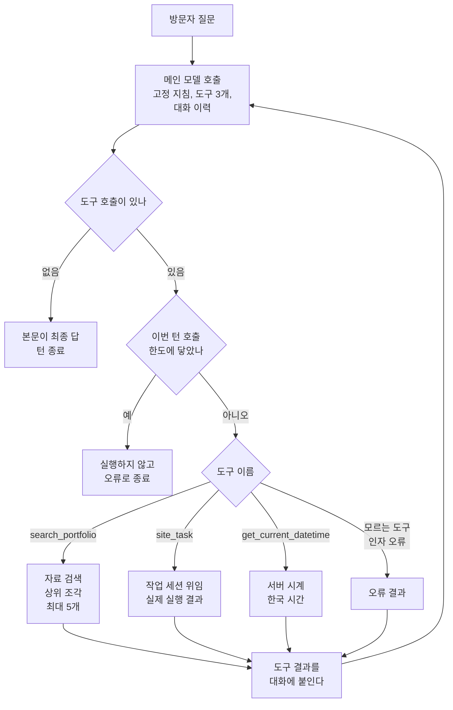
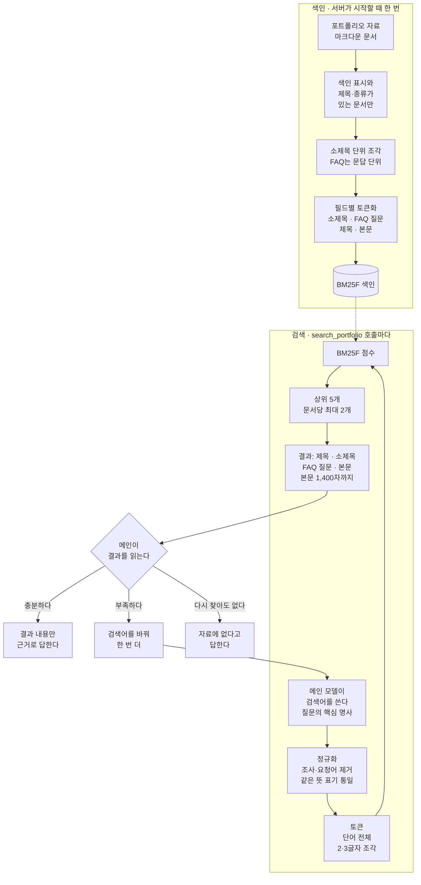
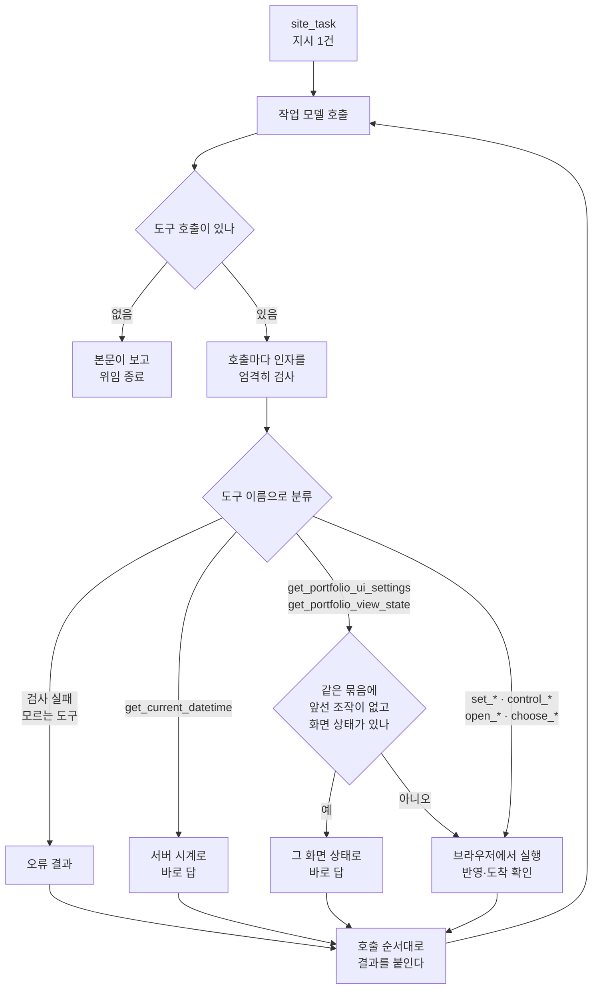
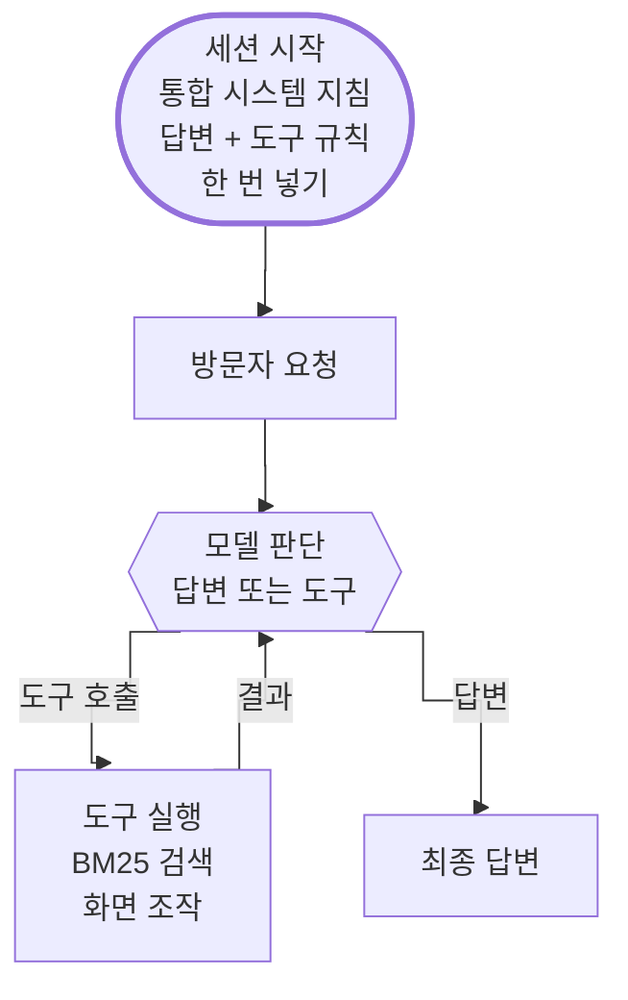
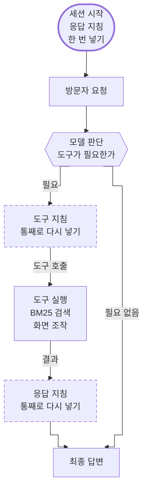
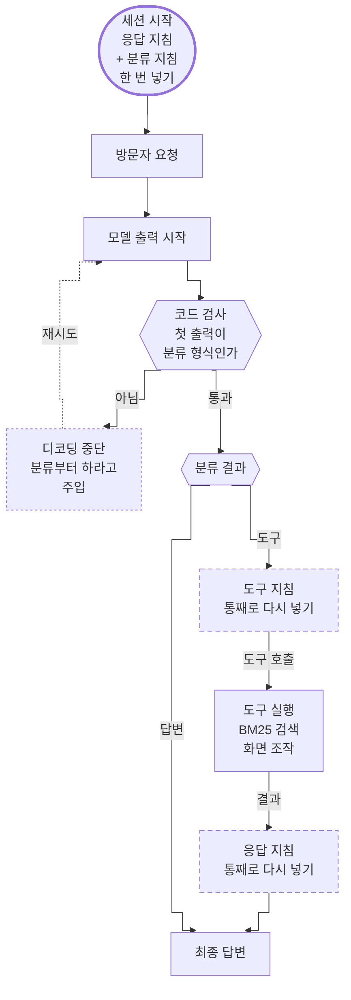
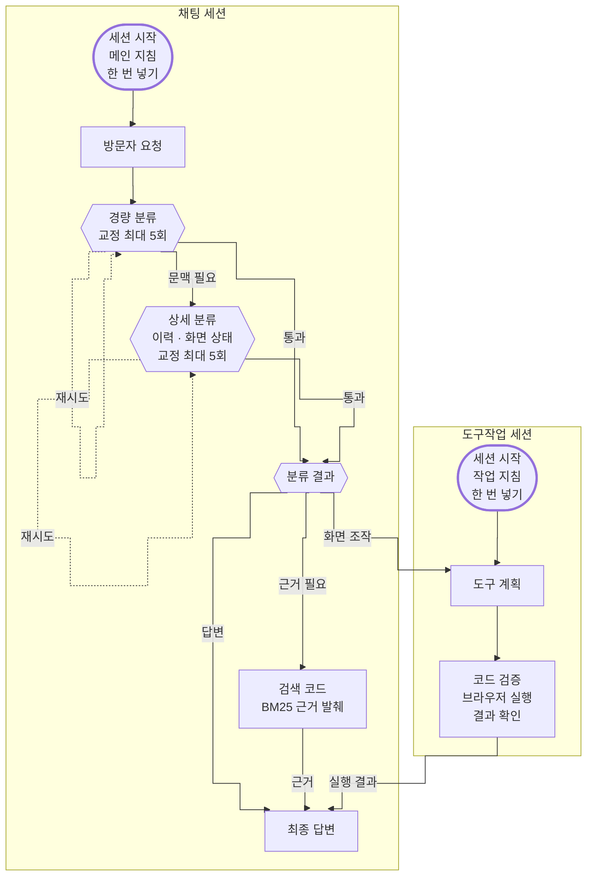
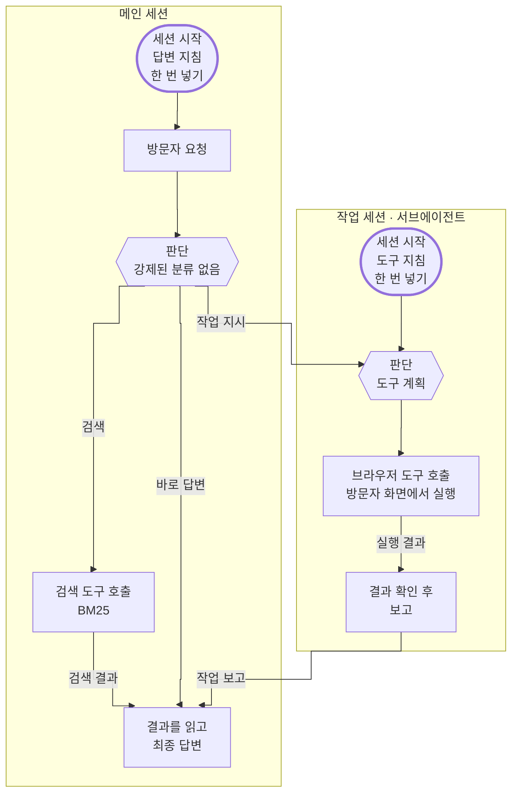

# 포트폴리오 챗봇 판단 흐름

챗봇이 질문을 받아 **바로 답할지, 자료를 찾을지, 화면을 바꿀지** 정하는 과정과 자료 검색(RAG)이
도는 방식을 정리한 문서다. 서버 코드는 비공개 저장소에 있어서 이 문서는 동작과 기준만 설명한다.
브라우저 쪽 구조는 [chatbot-architecture.md](chatbot-architecture.md)를 본다.

## 요약

- **질문을 미리 갈라 주는 분류기는 따로 없다.** 메인 세션의 모델이 호출될 때마다 바로 답할지, 어떤
  도구를 부를지 스스로 고른다(도구 호출, function calling). 서버는 모델이 고른 도구 이름에 따라
  정해진 실행기로 보낼 뿐이다.
- 그래서 분류 기준은 메인 세션의 고정 지침과 도구 설명에 있다. [2. 고르는 기준](#2-고르는-기준)에 정리했다.
- 자료 검색은 임베딩·벡터 DB 없이 **어휘 검색(lexical search)** 으로 한다. 검색어는 메인 모델이 쓰고,
  서버는 한국어에 맞게 정규화한 BM25F 점수로 상위 조각을 돌려준다.
- 화면 조작은 작업 세션이 맡는다. 작업 세션이 부른 도구는 **이름으로** 서버가 바로 답할 것과
  브라우저가 실행할 것으로 나뉜다. 이 분류만 규칙 기반이다.
- 지금 구조는 다섯 단계의 구조 실험 끝에 나왔다. [6. 지금 구조가 되기까지](#6-지금-구조가-되기까지)에 정리했다.

안내 데스크에 비유하면, 직원 한 명이 질문을 듣고 직접 자료실에 가서 찾아보거나 작업 담당에게 일을
넘긴다. 질문을 먼저 분류해 주는 접수 창구는 없다.

---

## 1. 메인 세션의 판단 루프

질문 하나(턴)에서 메인 모델은 도구 호출 없이 본문만 낼 때까지 여러 번 호출된다.

- 본문은 생성되는 대로 방문자에게 흘러간다. 도구를 부르기 전에 쓴 짧은 본문도 그대로 보이고,
  한 턴에 여러 번 나온 본문은 문단으로 이어 붙는다.
- 한 번의 호출에서 도구를 여러 개 부를 수 있다. 화면 조작과 설명을 함께 요청받으면 `site_task`와
  `search_portfolio`를 같이 부르고, 서버는 부른 순서대로 실행한다.
- 대화에는 질문, 답, 도구 결과만 쌓인다. 단계 표시나 교정 지시 같은 중간 지침을 끼워 넣지 않는다.
  잘못된 인자나 실패도 그 호출의 결과(`ok:false`)로 돌려주고, 모델이 다음 호출에서 고친다.
- 검색이나 위임이 시작되면 서버가 진행 단계를 먼저 알리고, 말풍선에 "자료 찾는 중", "화면 조작 중"이
  표시된다.

## 2. 고르는 기준

메인 세션의 고정 지침이 정한 기준이다.

| 요청 | 예 | 메인의 선택 |
| --- | --- | --- |
| 인사·감사·잡담 | "안녕하세요", "고마워요" | 도구 없이 바로 답한다 |
| 포트폴리오 사실 | "주력 언어가 뭐예요?" | `search_portfolio`를 먼저 부른다. 짧은 질문이라도 사실을 말하려면 검색한다 |
| 화면 조작 | "다크 모드로 바꿔 줘" | `site_task`로 맡긴다. 여러 조작은 한 번에 모아서 맡긴다 |
| 사이트의 작품·샘플 보여 주기 | "현대전 샘플 보여 줘", "리듬 게임 띄워 줘" | `site_task`로 그 카드로 이동하게 하고, `search_portfolio`로 찾은 내용으로 짧게 소개한다. "뭐야", "알려 줘"처럼 설명만 원하면 검색만 하고 화면은 그대로 둔다 |
| 값을 말하지 않은 설정 변경 | "포인트 색상 바꿔 줘" | 되묻지 않고 그대로 `site_task`로 맡긴다. 작업 세션이 선택지 버튼을 띄운다 |
| 날짜·시각 | "오늘 며칠이에요?" | `get_current_datetime` |
| 조작과 설명을 함께 | "2025년 연구 보여 주고 무슨 연구인지 설명해 줘" | `site_task`와 `search_portfolio`를 둘 다 부른다 |

`site_task`에 넘기는 지시에는 "작년", "여기", "아까 그거", "원래대로" 같은 상대 표현을 해석하지 않고
그대로 옮긴다. 지금 화면과 날짜를 확인할 수 있는 작업 세션이 해석한다.

결과를 읽는 기준도 지침에 있다.

- 검색 결과에 있는 내용만 포트폴리오 사실로 말한다. 결과가 부족하면 검색어를 바꿔 한 번 더 찾고,
  그래도 없으면 자료에 없다고 답한다.
- 위임 결과의 실행 내역에 성공으로 기록된 조작만 "바꿨다"고 말한다. 실패했거나 실행되지 않은 조작은
  그대로 알린다.
- 화면이 바뀌지 않은 결과(`no_action`)면 작업 세션이 확인한 값으로 답하거나, 필요한 정보를 짧게 묻는다.
  선택지를 띄웠으면 버튼을 누르면 바로 적용된다고만 안내한다.
- 도구 이름, 결과의 내부 형식, 문서 경로를 방문자에게 보여 주지 않는다.

### 모델이 고르기 때문에 생기는 일

이 판단은 규칙 엔진이 아니라 모델이 하므로 표현에 따라 갈릴 수 있다. 예를 들어 새 채팅의 첫 요청
"채팅 떼 줘"를 값이 없는 요청으로 보고 선택지를 띄운 적이 있다. 이런 경우는 분기 코드를 더하지 않고
도구 설명에 표현 예시("떼 줘"는 플로팅 창, "붙여 줘"는 고정 패널)를 넣어 바로잡는다.

매 요청마다 분류 단계를 거치도록 코드로 강제하던 때도 있었다(분류 자체는 그때도 모델이 했다). 지금은
메인 모델의 도구 호출 하나가 그 역할을 한다.
어떤 구조를 거쳐 여기까지 왔는지는 [6. 지금 구조가 되기까지](#6-지금-구조가-되기까지)에 정리했다.

## 3. 자료 검색(RAG)

도서관 색인 카드에 비유할 수 있다. 서버가 시작할 때 자료 문서를 소제목 단위로 잘라 카드로 만들어
두고, 질문이 오면 검색어의 단어가 어느 카드의 제목·소제목·본문에 나오는지, 그 단어가 전체 카드에서
얼마나 드문지로 점수를 매긴다. 정식 이름은 필드별 가중치를 둔 BM25(BM25F)다.

### 단계별 기준

| 단계 | 하는 일 | 이유 |
| --- | --- | --- |
| 자르기 | 문서를 소제목 단위 조각으로 나눈다. FAQ는 질문마다 따로 자른다 | 질문과 가장 가까운 단락만 모델에 넘기려고 |
| 필드 가중치 | 소제목 경로 > FAQ 질문 > 제목 > 본문 | 제목·소제목·FAQ 질문과 직접 일치한 조각을 긴 본문의 우연한 일치보다 위로 올리려고 |
| 정규화 | 유니코드 정규화(NFKC), 소문자화, 조사 떼기("포트폴리오에서" → "포트폴리오"), 요청 표현 빼기("알려 주세요", "설명해") | 형태소 분석기 없이 한국어 활용형을 맞추려고 |
| 같은 뜻 표기 | "기술 스택"은 언어·프레임워크·라이브러리까지 함께 찾고, "가장 많이"·"주로"는 "주력"으로, "AI"는 사이트 표기인 "SI"로 맞춘다 | 방문자 표현을 자료 문서의 표기에 맞추려고 |
| 토큰 | 단어 전체와 2·3글자 조각. 단어 일치가 가장 무겁고 2글자 조각이 가장 가볍다. C#, C++ 같은 이름은 조각내지 않는다 | 띄어쓰기·합성어 차이를 흡수하되 우연한 부분 일치는 약하게 |
| 다양성 | 상위 5개, 한 문서에서 최대 2개 | 긴 문서 하나가 결과를 독점하지 않게 |
| 결과 형식 | 제목, 소제목 경로, FAQ 질문, 본문만 넣는다. 문서 경로·ID는 넣지 않는다 | 모델이 내부 경로를 답변에 옮기지 않게 |

소유자의 답변 정책 문서는 검색 대상이 아니라 메인 세션의 고정 지침에 들어간다.

### 한계

- 어휘 검색이라 뜻은 같고 단어가 다르면 놓칠 수 있다. 자료에 "경력"으로 적힌 내용을 "일한 곳"으로
  찾으면 겹치는 단어가 없다. 메인 모델이 검색어를 질문의 핵심 명사로 다시 쓰고, 부족하면 한 번 더
  찾는 것으로 보완한다.
- 점수 하한선이 없어서 조금이라도 겹치는 조각은 결과에 들어간다. 관련 없는 조각을 걸러 내는 일은
  메인 모델이 맡는다.

## 4. 화면 조작: 작업 세션의 분류

`site_task` 지시 하나를 받은 작업 세션도 메인처럼 도구 호출 없이 보고만 낼 때까지 모델을 부른다.
다른 점은 작업 세션이 부른 도구를 서버가 **이름으로** 나눈다는 것이다.

브라우저로 갈 호출은 한 묶음으로 모아 왕복 한 번에 보낸다. 앞선 조작이 있으면 질문과 함께 온 화면 상태가
이미 낡았으므로, 조회도 브라우저에서 다시 한다.

작업 세션의 고정 지침은 다음과 같다.

| 상황 | 처리 |
| --- | --- |
| "여기", "지금 보는", "현재 값" | 기억에 기대지 않고 조회 도구로 먼저 확인한다. 방문자가 채팅 밖에서 바꿨을 수 있다 |
| "올해", "작년" 같은 상대 날짜 | 서버 시계로 연도를 확인하고 이동한다. 사이트에 없는 연도면 이동하지 않고 보고한다 |
| "되돌려", "원래대로" | 앞서 바꾼 결과에 담긴 이전 값으로 되돌린다. 기록이 없으면 실행하지 않고 보고한다 |
| 바꿀 설정은 정했는데 값이 없거나 지원하지 않는 값 | 선택지 버튼을 띄우고, 띄웠다고만 보고한다 |
| 그 밖에 대상이나 값이 모호함 | 추측해서 실행하지 않고 무엇이 필요한지 보고한다 |
| 도구가 실패함 | 인자를 고칠 수 있을 때만 한 번 고쳐서 다시 부른다 |
| 지시에 없는 조작, 이전 지시 | 덧붙이지 않고, 이미 끝난 이전 지시는 다시 실행하지 않는다 |

메인 세션은 작업 세션의 보고와 함께 **서버가 기록한 실행 내역**을 받는다. 보고 문장이 아니라 이 내역으로
결과 상태를 정한다.

| 결과 상태 | 뜻 |
| --- | --- |
| `completed` | 화면 변경이 있었고 모두 성공 |
| `partial` | 화면 변경 일부만 성공 |
| `failed` | 화면 변경이 모두 실패했거나, 변경 없이 작업 세션 오류·단계 한도 |
| `no_action` | 화면 변경 없음. 조회만 했거나, 되물을 것이 있거나, 선택지만 띄웠다 |
| `cancelled` | 새 질문·시간 초과·채팅 종료로 중단 |

## 5. 한도

| 항목 | 기본값 | 넘으면 |
| --- | --- | --- |
| 메인 모델 호출 | 턴당 10회 | 마지막 도구 호출은 실행하지 않고 턴을 오류로 끝낸다 |
| 작업 모델 호출 | 위임 1건당 20회 | 마지막 호출 묶음을 실행하지 않고 `failed`나 `partial`로 돌려준다 |
| 브라우저 왕복 한 번의 도구 수 | 20개 | 넘친 호출은 실행하지 않고 알려서 작업 세션이 나눠 부르게 한다 |
| 브라우저 결과 대기 | 120초 | 남은 호출을 시간 초과로 채우고 `cancelled`로 끝낸다 |
| 빈 응답 | | 대화를 바꾸지 않고 같은 요청을 한 번 다시 보낸다 |

## 6. 지금 구조가 되기까지

답변과 화면 조작을 한 챗봇 안에서 어떻게 나눌지 다섯 단계에 걸쳐 실험했다. 단계마다 바꿔 본 것은
두 가지다.

- **지침을 넣는 방식**: 대화 처음에 한 번 넣을지, 역할이 바뀔 때마다 다시 넣을지
- **분류 방식**: 답변인지 도구 호출인지를 모델이 필요할 때 정할지, 매 요청마다 분류 단계를 거치도록
  코드로 강제할지

> [!NOTE]
> **실험 모델과 결과의 범위**
>
> 실험에 쓴 모델은 [gemma4-26b-a4b-it-qat-w4a16-ct](https://huggingface.co/reinforce20001/gemma4-26b-a4b-it-qat-w4a16-ct)다.
> Gemma 4 26B A4B 지시 조정 모델의 가중치를 4비트로 양자화한 버전이다.
> 아래 결과는 이 모델에서 관찰한 것이라 절대적이지 않다. 모델의 성능이나 크기가 바뀌면 어느 구조가
> 잘 동작하는지도 언제든 달라질 수 있다.

```mermaid
---
config:
  flowchart:
    curve: step
---
flowchart TB
  subgraph s1["1단계 · 통합 시스템 지침"]
    direction LR
    U1["요청"] --> A1["세션 하나<br/>통합 지침<br/>처음에 한 번"] --> O1["답변 · 도구 호출"]
  end
  subgraph s2["2단계 · 지침 전환"]
    direction LR
    U2["요청"] --> A2["세션 하나<br/>모델이 판단"] -->|"도구가 필요하면"| R2["도구 지침, 응답 지침<br/>차례로<br/>통째로 다시 넣기"] --> O2["같은 세션에서<br/>도구 호출 뒤 답변"]
  end
  subgraph s3["3단계 · 분류 강제"]
    direction LR
    U3["요청"] --> C3{{"분류 단계<br/>모델이 분류<br/>코드가 강제"}} -->|"도구"| R3["도구 지침, 응답 지침<br/>차례로<br/>통째로 다시 넣기"] --> A3["같은 세션에서<br/>답변"]
    C3 -->|"답변"| A3
    C3 -.->|"교정 후 재시도"| C3
  end
  subgraph s4["4단계 · 세션 분리 + 분류 강제"]
    direction LR
    U4["요청"] --> C4{{"경량 · 상세 분류<br/>채팅 세션이 분류<br/>코드가 강제"}}
    C4 -.->|"교정 후 재시도 · 최대 5회"| C4
    C4 -->|"답변"| M4["채팅 세션<br/>답변 지침<br/>처음에 한 번"]
    C4 -->|"도구"| W4["도구작업 세션<br/>도구 지침<br/>처음에 한 번"]
  end
  subgraph s5["5단계 · 메인과 서브에이전트 (현재)"]
    direction LR
    U5["요청"] --> M5["채팅 세션 · 메인<br/>답변 지침<br/>처음에 한 번"]
    M5 <-->|"필요할 때 호출 · 결과"| W5["도구 세션 · 서브<br/>도구 지침<br/>처음에 한 번"]
    M5 --> O5["답변"]
  end
  s1 ~~~ s2 ~~~ s3 ~~~ s4 ~~~ s5
  classDef reinject stroke-dasharray: 6 4
  class R2,R3 reinject
```

### 1단계 · 통합 시스템 지침

- 답변 규칙과 도구 사용 규칙을 함께 담은 통합 시스템 지침 하나를 세션 하나에 넣었다. 지침은 요청마다가
  아니라 대화 처음에 한 번만 넣었다.
- 세션 하나가 채팅 답변과 도구 호출을 모두 맡았다. 포트폴리오 검색도 BM25로 자료를 찾는 도구였고, 모델이
  화면 조작 도구와 함께 직접 불렀다.
- **문제**: 지침끼리 간섭했다. 일반 질문을 화면 조작 요청으로 보고 도구를 잘못 부르는 일이 잦았다.

### 2단계 · 지침 전환

- 답변 지침과 도구 사용 지침을 나눴다. 답변해야 하면 답변 지침으로, 도구를 불러야 하면 도구
  지침으로 바꿔 가며 진행했다. 무엇을 할지는 여전히 모델이 판단했다.
- 지침을 바꿀 때마다 시스템 지침을 통째로 다시 넣었다. 도구를 쓰면 도구 지침을 넣고, 최종 답변 전에 응답
  지침을 다시 넣어 긴 지침이 두 번 더 들어갔다.
- **문제**: 큰 지침을 전환마다 다시 넣는 부담이 컸다. 모델이 판단을 건너뛰고 바로 답하기도 했고,
  대화 중간에 지침이 바뀌면서 대화 구조가 꼬였다.

### 3단계 · 분류 강제

- 모든 요청 앞에 분류 단계를 두어 답변인지 도구 호출인지부터 정하게 했다. 분류 자체는 모델이 했지만,
  2단계처럼 판단을 건너뛰지 못하도록 이 단계를 반드시 거치게 하는 것은 코드로 강제했다.
- 분류 지침은 시스템 지침에 더해 넣었다. 첫 출력이 정해진 분류 형식이 아니면 코드가 디코딩을 멈추고,
  분류부터 하라는 내용을 넣어 다시 시도하게 했다.
- 정해진 역할은 같은 세션이 그 역할의 지침으로 바꿔 이어서 맡았다. 도구를 쓰면 2단계처럼 도구 지침과
  응답 지침을 차례로 다시 넣었다.
- **문제**: 분류 단계는 빠짐없이 거치게 됐지만, 역할을 전환하며 지침을 다시 넣는 방식은 그대로였다.
  세션 하나에 두 역할의 내용이 쌓여 문맥도 빠르게 커졌다.

### 4단계 · 세션 분리 + 분류 강제

- 채팅 세션과 도구작업 세션을 나눴다. 전환하며 다시 넣던 지침을, 세션마다 처음에 한 번만 넣는
  형태로 바꾸려는 시도였다. 역할별로 미세조정(LoRA)을 붙이기 쉬워진 것은 덤이었다.
- 분류 단계를 코드로 강제하는 방식은 유지했다. 분류용 모델을 따로 두지 않고, 메인인 채팅 세션이 자기
  문맥 캐시를 그대로 써서 어느 세션이 맡을지 정했다.
- 분류는 두 겹이었다. 경량 분류로 먼저 나누고, 이력과 화면 상태가 필요하면 그 문맥을 붙여 상세 분류를
  한 번 더 했다. 두 분류 모두 형식이 어긋나면 교정해 최대 5회 다시 요청했다.
- 도구작업 세션이 계획한 조작은 코드가 검증해 브라우저에서 실행했고, 실행 결과는 채팅 세션으로 돌아와
  최종 답변이 됐다.
- **문제**: 코드가 첫 분류를 강제하고 어긋나면 교정하게 했는데, 이 교정에 호출 비용이 들고 실패도
  잦았다. 분류가 틀리면 엉뚱한 세션으로 갔고, 단계 전환과 교정 처리도 복잡해졌다. 실제 모델로
  시험했을 때는 첫 질문부터 메인 처리가 실패 안내로 끝났다.

### 5단계 · 메인과 서브에이전트 (지금)

- 세션 분리는 그대로 두고 분류 강제를 없앴다. 채팅 세션이 메인으로 대화를 맡고, 화면 조작이 필요할
  때만 도구 세션을 도구처럼 부른다(서브에이전트 방식). 두 세션이 강제된 단계 없이 협업한다.
- 세션마다 지침은 처음에 한 번만 넣고 끝까지 바꾸지 않는다. 나중에는 역할별 미세조정(LoRA)을 붙여
  지침 대부분을 가중치로 옮길 계획이다.
- 위 실험 모델에서는 지금까지 시험한 구조 중 가장 잘 동작한다.

### 돌아보면

- 지침은 "처음에 한 번"(1단계)에서 "역할마다 바꿔 가며 다시"(2·3단계)를 거쳐 다시 "처음에
  한 번"(4·5단계)으로 돌아왔다. 1단계와 다른 점은 지침을 역할별 세션으로 나눴다는 것이다. 세션 하나가
  지침 하나만 가지므로 바꿔 넣을 일이 없다.
- 분류는 처음부터 끝까지 모델이 했다. 바뀐 것은 분류를 거치는 방식이다. "모델이 필요할 때"(1·2단계)에서
  "매 요청마다 거치도록 코드가 강제"(3·4단계)를 거쳐 다시 "모델이 필요할 때"(5단계)로 돌아왔다. 지금은
  메인이 고르는 것이 따를 지침이 아니라 부를 도구라는 점이 다르다.
- 1절의 원칙, 곧 대화 중간에 지침을 끼워 넣지 않고 세션마다 지침을 고정한다는 것은 이 과정에서 나왔다.
